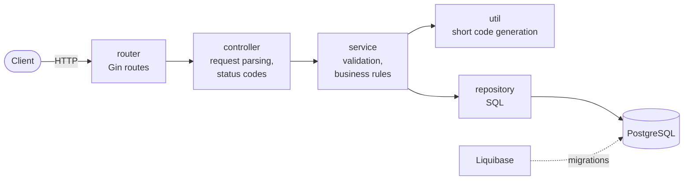

# URL Shortener

[](https://github.com/sdhiren/url-shortener/actions/workflows/ci.yml)

A URL shortening service written in Go, using [Gin](https://gin-gonic.com/) and PostgreSQL.
You send it a long URL and it gives you a short link; opening the short link redirects to the original URL and counts the click.

## Contents

- [Features](#features)
- [Architecture](#architecture)
- [Quick start](#quick-start)
- [Configuration](#configuration)
- [API reference](#api-reference)
- [Development](#development)
- [CI](#ci)
- [Contributing](#contributing)
- [Status and roadmap](#status-and-roadmap)

## Features

- Shorten any public `http`/`https` URL to an 8-character code.
- Short links redirect with `302 Found` (configurable) and count every click atomically, so no clicks are lost under concurrent traffic.
- A JSON lookup API (`GET /url/:code`) returns a short link's target without counting a click.
- The same long URL always returns the same short code, even under concurrent requests (one row per URL).
- Hash collisions are detected and resolved, so a short link can never be taken over by a different URL (see [How short codes work](#how-short-codes-work)).
- Strict URL validation, with a clear reason when a URL is rejected (see [URL validation rules](#url-validation-rules)).
- JSON errors with proper HTTP status codes; internal errors are logged, never sent to clients.
- Structured logs with `log/slog` (JSON in release mode), one line per request, and a request ID (`X-Request-ID`) on every response and log line.
- Typed, validated configuration from environment variables: the service lists every invalid setting at startup.
- Database schema managed with Liquibase migrations.
- Runs locally with one command through Docker Compose.

## Architecture



Each layer depends only on the interface of the layer below, so the tests use generated mocks.

| Path | Purpose |
|---|---|
| `main.go` | Loads config, connects to Postgres, starts the HTTP server |
| `router/` | Wires dependencies together and registers the routes |
| `src/controller/` | HTTP handlers: parse requests, map errors to status codes |
| `src/service/` | Business logic: URL validation, de-duplication, building short URLs |
| `src/repository/` | Postgres queries |
| `src/util/` | Short code generation (first 8 characters of a base64url SHA-256 hash; see [How short codes work](#how-short-codes-work)) |
| `src/config/` | Loads and validates configuration from the environment |
| `src/domain/` | Domain errors shared across layers |
| `src/logging/` | `slog` setup, request-ID and request-logging middleware, request-scoped logger in `context.Context` |
| `model/request/`, `model/response/` | JSON request and response bodies |
| `mocks/` | Generated mocks (`make generate`); don't edit by hand |
| `infrastructure/changelog/` | Liquibase changelog and SQL migrations |

### How short codes work

1. The code is the first 8 characters of the base64url-encoded SHA-256 hash of the long URL, so the same URL always maps to the same code.
2. The service runs `INSERT … ON CONFLICT (SHORT_URL) DO NOTHING`. The `SHORT_URL` column has a unique constraint, so exactly one row per code can exist.
3. If the code was already taken, the service reads which URL owns it:
   - **The same URL** (shortened earlier, or by a concurrent request): the existing link is returned. No duplicate row is created.
   - **A different URL** (a hash collision): the service retries with a salted hash (`url + "\x00" + attempt`), up to 5 attempts. The first attempt is unsalted, so existing codes never change, and the salt sequence is deterministic, so shortening the same URL again finds its salted code. Collisions are logged.

With 48-bit codes a natural collision is very unlikely, but this also stops a deliberately planted row from taking over someone else's link.

## Quick start

**Prerequisites:** [Docker](https://docs.docker.com/get-docker/) with Docker Compose, and `make`.

```bash
cp .env.example .env
```

Edit `.env` and set at least `DB_PASSWORD`. Then start Postgres, run the migrations and start the API:

```bash
make start
```

Shorten a URL:

```bash
curl -s -X POST http://localhost:8080/shorten -H 'Content-Type: application/json' -d '{"url": "https://example.com/some/long/path"}'
```

```json
{"short_url":"http://localhost:8080/Xy12Ab34","code":"Xy12Ab34"}
```

Open the short link (in a browser, or with `curl -i` to see the redirect):

```bash
curl -i http://localhost:8080/Xy12Ab34
```

```text
HTTP/1.1 302 Found
Cache-Control: no-store
Location: https://example.com/some/long/path
```

Look up where a short link points, without following it or counting a click:

```bash
curl -s http://localhost:8080/url/Xy12Ab34
```

```json
{"code":"Xy12Ab34","long_url":"https://example.com/some/long/path"}
```

Stop everything with `make stop`, or `make stopv` to also delete the database volume.

## Configuration

All configuration comes from environment variables. With Docker Compose they are read from `.env`, which is gitignored; `.env.example` lists them all. Never commit real values.

| Variable | Required | Default | Allowed values |
|---|---|---|---|
| `PORT` | no | `8080` | 1–65535 |
| `BASE_URL` | no | `http://localhost:<PORT>/` | absolute `http`/`https` URL, no credentials, query or fragment, path not `/url/`; a trailing `/` is added if missing |
| `APP_MODE` | no | `release` | `debug`, `release`, `test`; also selects the log format |
| `REDIRECT_STATUS` | no | `302` | `301`, `302`, `307`, `308`; any other value logs a warning and uses `302` |
| `DB_USER` | yes | | |
| `DB_PASSWORD` | yes | | wrap in single quotes in `.env` if it contains `$` |
| `DB_HOST` | yes | | `db` inside Docker Compose, `localhost` when running the API on your machine |
| `DB_PORT` | no | `5432` | 1–65535 |
| `DB_NAME` | yes | | |
| `DB_SSLMODE` | no | `disable` | `disable`, `allow`, `prefer`, `require`, `verify-ca`, `verify-full` |

`BASE_URL` is the public address of the service. Short links are built by appending the code to it, and the redirect route is served under its path, so in production set it to your real domain, e.g. `https://sho.rt/`. Its path can't be `/url/`, because that is where the lookup API lives.

`REDIRECT_STATUS` is the status code short links redirect with. Keep the default `302` unless you have a reason not to: browsers cache permanent redirects (`301`, `308`) and stop asking the server, so repeat clicks from the same browser are no longer counted, and changing or deleting a link won't reach them.

`APP_MODE` sets Gin's mode. It's used instead of Gin's own `GIN_MODE`, because Gin crashes on an invalid `GIN_MODE` before the service can validate it.

If any setting is invalid, the service prints every problem at once and exits:

```text
Invalid configuration:
invalid PORT "abc": must be a number between 1 and 65535
missing required environment variables: DB_USER, DB_PASSWORD, DB_HOST, DB_NAME
```

## Logging

The service logs with Go's `log/slog` to stdout:

- **`APP_MODE=release`**: one JSON object per line, ready for a log collector.
- **`debug` / `test`**: human-readable `key=value` text.

Every request gets an ID. A valid incoming `X-Request-ID` header is reused (1–64 characters of `A–Z a–z 0–9 . _ -`); otherwise a random 32-character hex ID is generated. Either way it's returned in the `X-Request-ID` response header and added to every log line for that request, so a client-reported ID leads straight to the logs.

Each request ends with one `request` line:

```json
{"time":"…","level":"INFO","msg":"request","request_id":"b0ce5157…","method":"GET","path":"/9bs-5Xvc","route":"/:code","status":302,"duration_ms":1,"client_ip":"192.168.65.1","bytes":47}
```

- Requests with a 5xx status log at `ERROR`; everything else logs at `INFO`.
- Unexpected errors add a `request failed` line with the full error chain, which is never sent to the client.
- Short-code collisions log a `WARN` line.
- A panic in a handler is recovered into a generic 500 and logged with its stack trace.

Code that has a request context logs with `logging.FromContext(ctx)`, so the request ID is included automatically.

If the configuration is invalid, the service prints the problems as plain text to stderr and exits, because the log format isn't known until the configuration loads.

## API reference

All request and response bodies are JSON. Errors always have the shape `{"error": "<message>"}`.

### `POST /shorten`

Creates a short URL, or returns the existing one if this long URL was shortened before.

**Request**

```json
{"url": "https://example.com/some/long/path"}
```

**Responses**

| Status | Body | When |
|---|---|---|
| `201` | `{"short_url": "http://localhost:8080/Xy12Ab34", "code": "Xy12Ab34"}` | Shortened, or already existed (the existing code is returned) |
| `400` | `{"error": "url is required"}` | `url` is missing or empty |
| `400` | `{"error": "request body must be JSON like {\"url\": \"https://example.com\"}"}` | Body is not valid JSON, or `url` is not a string |
| `400` | `{"error": "invalid url: <reason>"}` | URL fails validation (see below) |
| `500` | `{"error": "internal server error"}` | Unexpected error, e.g. the database is down; details are in the server log |

```bash
curl -i -X POST http://localhost:8080/shorten -H 'Content-Type: application/json' -d '{"url": "https://example.com"}'
```

### `GET /:code`

Redirects to the original URL and counts one click. This is the short link itself, so the route lives under the path of `BASE_URL`: with `BASE_URL=https://example.com/s/` it is `GET /s/:code`.

```bash
curl -i http://localhost:8080/Xy12Ab34
```

| Status | Headers / body | When |
|---|---|---|
| `302` | `Location: <long url>`, `Cache-Control: no-store` | Code exists; the click is counted. The status is `REDIRECT_STATUS` if set |
| `404` | `{"error": "short url not found"}` | Unknown code, or a code that can't exist (not 1–20 characters of `A–Z a–z 0–9 - _`) |
| `500` | `{"error": "internal server error"}` | Unexpected error |

- It's a `302`, not a `301`, by default: browsers cache `301` redirects and stop asking the server, so later clicks would never be counted. `Cache-Control: no-store` has the same purpose. Set `REDIRECT_STATUS=301` to opt in anyway.
- Non-ASCII characters in the long URL are percent-encoded in `Location`, as HTTP requires; browsers decode them back.
- Each click is counted with a single atomic `UPDATE … SET CLICK_COUNT = CLICK_COUNT + 1`, so concurrent clicks are never lost.

### `HEAD /:code`

Same status and `Location` as `GET`, but **doesn't count a click**, so link checkers and preview bots don't inflate the numbers.

### `GET /url/:code`

Returns where a short link points as JSON, without redirecting or counting a click. Unlike the redirect, this API route is always at the root, whatever the path of `BASE_URL`.

```bash
curl -s http://localhost:8080/url/Xy12Ab34
```

| Status | Body | When |
|---|---|---|
| `200` | `{"code": "Xy12Ab34", "long_url": "https://example.com/some/long/path"}` | Code exists |
| `404` | `{"error": "short url not found"}` | Unknown code, or a code that can't exist |
| `500` | `{"error": "internal server error"}` | Unexpected error |

### URL validation rules

Surrounding whitespace is trimmed first. A URL is rejected with `400` if it:

| Rule | Example of a rejected URL |
|---|---|
| is empty | `""` |
| is longer than 1000 characters | |
| contains spaces or control characters | `https://example.com/a b` |
| doesn't use `http` or `https` | `www.example.com`, `ftp://…`, `javascript:…` |
| has no host | `https://` |
| contains a username or password | `https://google.com@evil.example` |
| has a port outside 1–65535 | `https://example.com:0` |
| has an invalid host name | `https://-example.com`, `https://999.1.1.1` |
| isn't a public domain with a TLD | `http://localhost`, `https://intranet/` |
| points to a private, loopback or reserved IP | `http://127.0.0.1`, `http://192.168.1.1`, `http://169.254.169.254` |
| points back to this shortener's `BASE_URL` | `https://sho.rt/abc123` |

Unicode domains such as `https://münchen.de` are accepted.

## Development

**Prerequisites:** Go (the version in [`go.mod`](go.mod); Go downloads it automatically if yours is older), Docker, `make`.

### Run the API on your machine

Start only Postgres and the migrations in Docker:

```bash
docker compose up -d db liquibase
```

Then run the API with `DB_HOST=localhost` (the other values come from your `.env`):

```bash
set -a; source .env; set +a; DB_HOST=localhost go run .
```

### Make targets

| Command | What it does |
|---|---|
| `make start` / `make stop` / `make stopv` | Start / stop the Docker Compose stack (`stopv` also deletes the DB volume) |
| `make migrate` | Run the Liquibase migrations against the Compose database |
| `make test` | Run all tests with the race detector and coverage |
| `make coverage` | Run tests, write `coverage.out`, and fail if total coverage is below `COVERAGE_MIN` (80%) |
| `make lint` | Run [golangci-lint](https://golangci-lint.run/) with `.golangci.yml` |
| `make generate` | Regenerate mocks in `mocks/` with `mockgen` |
| `make check-generate` | Fail if the committed mocks are out of date |
| `make tidy-check` | Fail if `go.mod` / `go.sum` aren't tidy |
| `make vuln` | Scan dependencies for known vulnerabilities with `govulncheck` |
| `make deps-update` | Update all dependencies and tidy |

### Mocks

Interfaces in `src/service`, `src/repository` and `src/util` have `//go:generate` directives. `mockgen` is pinned as a Go tool in `go.mod`, so `make generate` always uses the same version. Run it after changing an interface, and commit the result.

### Database migrations

Migrations live in `infrastructure/changelog/`. To add one, put a new SQL file in `sql/` and add a `changeSet` for it to `changelog.xml`. Docker Compose runs Liquibase on `make start`; run `make migrate` to apply new migrations to a running stack.

| Migration | Change |
|---|---|
| `001` | Creates the `URLS` table |
| `002` | Renames `COUNTER_VALUE` to `CLICK_COUNT` (default 0); old values reset, since they counted shorten requests |
| `003` | Merges duplicate rows (summing clicks), keeps the oldest row of any collision, adds a unique constraint on `SHORT_URL`, and adds `CREATED_AT` |

Never edit a migration that has already been applied: Liquibase checksums each changeset, so changes go in a new file.

## CI

[GitHub Actions](.github/workflows/ci.yml) runs on every pull request and every push to `main`:

| Job | Checks |
|---|---|
| **Lint** | `go mod tidy`, mocks up to date, `go vet`, golangci-lint |
| **Test** | tests with the race detector, coverage of at least 80% (summary on the run page, report uploaded as an artifact) |
| **Security** | `govulncheck`, and a [gitleaks](https://github.com/gitleaks/gitleaks) secret scan with custom rules in `.gitleaks.toml` |
| **Docker image** | builds the image on PRs; on `main`, also pushes it to `ghcr.io/sdhiren/url-shortener` tagged with the commit SHA and `latest` |

Dependabot ([config](.github/dependabot.yml)) opens weekly PRs for Go modules, GitHub Actions and the Docker base image.

## Contributing

- `main` is protected: all changes go through a pull request, and PRs are squash-merged.
- Use one branch and one PR per backlog item.
- Commit messages and PR titles use the style `Dhiren: <short lowercase summary>`. With squash merges, the PR title becomes the commit on `main`.
- Before opening a PR, run `make lint test check-generate tidy-check`. `golangci-lint fmt` fixes formatting and import grouping (standard library, third-party, then `urlshortener/...`).
- Pass `c.Request.Context()` from handlers, not the `*gin.Context`: only the request context is canceled when the client disconnects.
- Never commit secrets. Put them in `.env`, which is gitignored. CI scans every PR for leaks.
- If a change affects setup, configuration or the API, update this README in the same PR.

## Status and roadmap

This project is being turned into a production-ready service, one item at a time. [`BACKLOG.md`](BACKLOG.md) has the full prioritized list. Known limitations right now:

- Click counts are stored but there's no API to read them yet (F-03 / F-04).
